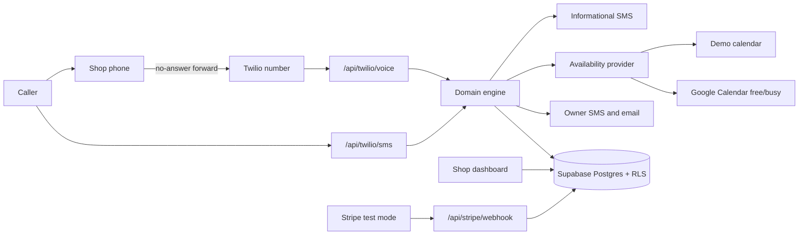

# Architecture

LeadRescue AI is a multi-tenant Next.js app. The marketing site, the fictional demo, and the signed-in shop portal are separate route groups. They share one domain engine.

## Modules

| Path | Role |
| --- | --- |
| `lib/engine` | Pure missed-call, reply, follow-up, and booking transitions. |
| `lib/compliance` | Quiet hours, STOP/HELP/START, informational copy. |
| `lib/assistant` | Rule-based sandbox assistant and optional LLM wording. |
| `lib/booking` | `AvailabilityProvider`. Demo slots, or Google free/busy when credentials exist. |
| `lib/billing` | Plan catalog, overage math, Stripe event snapshots. |
| `lib/reports` | Weekly scorecard. |
| `lib/store` | Memory sandbox store, or Supabase service-role store for webhooks. |
| `app/(marketing)` | Public pages. No tenant data. |
| `app/(portal)` | Login, onboarding, and the per-shop dashboard. |
| `supabase/migrations` | Schema, private `app` helpers, and RLS. |

## Tenancy

A user belongs to one business through `memberships`. Policies call `app.tenant_ids_for_user()`, a security-definer function in the private `app` schema. It reads memberships with `auth.uid()`. It does not read `user_metadata`.

Billing counters live on `subscriptions`, which authenticated users can read and cannot update. A2P approval is a locked column on `tenants`.

Webhooks run with the service role and look up the tenant by the Twilio number that received the call or text. They never trust a tenant id supplied by the caller.

## Sandbox rule

Every external system has a mode:

| System | Live when | Otherwise |
| --- | --- | --- |
| Supabase | URL and publishable key, plus a secret for writes from webhooks | In-memory Demo HVAC Co, or an onboarding cookie |
| Twilio | Account SID and auth token, and a valid signature | Unsigned requests return 503 unless `x-leadrescue-sandbox: 1` |
| SMS send | Twilio configured and `a2p_brand_status = approved` | `sandbox_not_sent` or `blocked_a2p` |
| Assistant | `OPENAI_API_KEY` | Deterministic script, labeled sandbox |
| Google Calendar | Client id, secret, and refresh token, and the shop selected Google | Demo openings, labeled sandbox |
| Email | Resend key and from-address | Escalation text is stored, not delivered |
| Stripe | `sk_test_` key | Checkout explains sandbox and creates no session. `sk_live_` is refused |

The interactive demo at `/demo` never calls Twilio. It runs the same engine in the browser with `delivery: sandbox_not_sent`.

## Booking flow

1. Voice webhook treats an inbound call to the shop's LeadRescue number as a missed call.
2. The engine prepares one informational text, or queues it until quiet hours end.
3. Replies identify repair, maintenance, install, or emergency.
4. Qualifying questions collect the issue, system type, ZIP, and a safety check.
5. A YES is required before any of the three follow-ups.
6. Three openings are offered. A name confirms the booking through the provider.

Emergencies skip booking, tell the caller to leave and call 911 when appropriate, and notify the owner.
